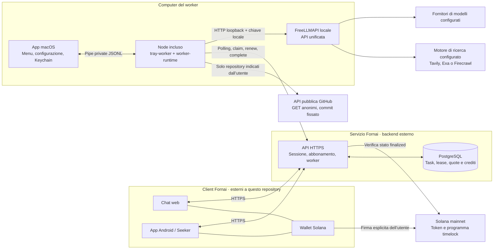
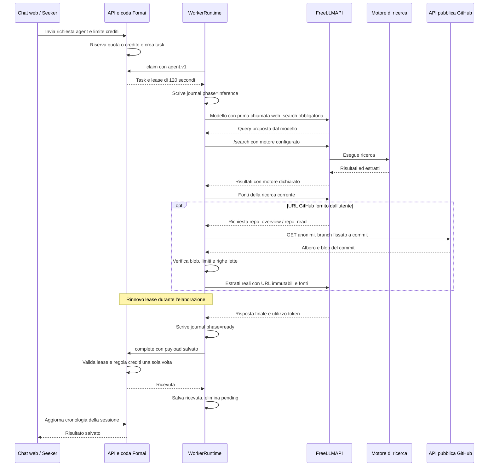
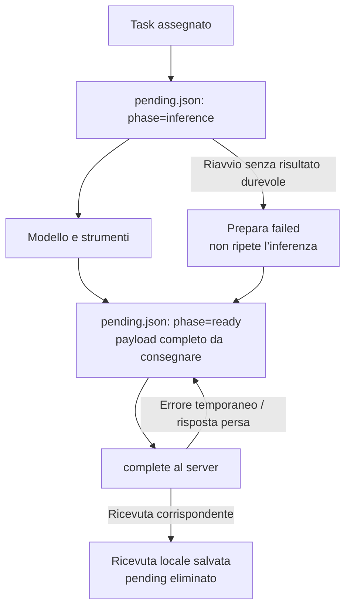

# Architettura di Fornai Worker

Fornai collega una chat sul sito o su Seeker a un worker installato sul computer dell’utente. Il worker prende una richiesta dalla coda, usa FreeLLMAPI locale per interrogare i fornitori configurati e consegna il risultato a Fornai. Tutte le connessioni partono dal computer: non occorre esporre FreeLLMAPI su Internet o aprire una porta in ingresso.

Questo repository pubblica **l’app macOS e il runtime JavaScript condiviso del worker**. Il sito, il backend, l’app Android/Seeker e l’interfaccia Windows sono componenti del sistema più ampio, ma i loro sorgenti non sono inclusi qui. Le sezioni che li descrivono spiegano il contratto di integrazione attuale; compilare questo repository non installa un server Fornai completo.

Per installazione e configurazione vedi [Fornai Worker per macOS](MACOS-WORKER.md). Per i termini applicabili ai sorgenti vedi [LICENSE](../LICENSE).

## 1. Vista del sistema

Il diagramma rappresenta flussi di dati, non un trasferimento della chiave privata del wallet. Il worker riceve un token limitato alle operazioni worker. La chiave unificata FreeLLMAPI serve alle chiamate locali; il worker non la invia alle API Fornai o GitHub.

## 2. Dove si trova il codice

| Area pubblicata | File | Responsabilità e simboli principali |
| --- | --- | --- |
| Avvio e barra dei menu | [Main.swift](../tools/macos-worker/Sources/Main.swift) | Ciclo di vita dell’app, finestra, menu e smoke test della UI. |
| Interfaccia macOS | [WorkerView.swift](../tools/macos-worker/Sources/WorkerView.swift) | Stato, crediti, configurazione e comandi dell’utente. |
| Controller nativo | [WorkerCore.swift](../tools/macos-worker/Sources/WorkerCore.swift) | `WorkerController`, `WorkerKeychain`, `WorkerHTTP`, `WorkerChild`: salvataggio, pairing, chiamate HTTP e gestione del processo Node. |
| Validazione nativa | [Policy.swift](../tools/macos-worker/Sources/Policy.swift) | `WorkerConfiguration`, `WorkerPolicy`, `WorkerLineDecoder`: endpoint consentiti, wallet, token, configurazione e messaggi IPC. |
| Adattatore desktop | [tray-worker.mjs](../scripts/tray-worker.mjs) | `runTrayWorker`, `createHostCredentialStore`: traduce runtime e comandi nativi in messaggi JSONL; attende la conferma del salvataggio credenziali. |
| Motore condiviso | [worker-runtime.mjs](../scripts/worker-runtime.mjs) | `WorkerRuntime`, `agentInput`, `PublicRepositoryReader`: coda, lease, recupero, modelli, ricerca e lettura GitHub. |
| Distribuzione | [build-macos-worker.sh](../scripts/build-macos-worker.sh), [Info.plist](../tools/macos-worker/Info.plist) | Compilazione, Node incluso, icona, firma ad hoc, test e archivio. |
| CI | [macos-worker.yml](../.github/workflows/macos-worker.yml) | Build e verifiche su runner Apple Silicon e Intel. |

Le altre interfacce desktop possono riusare `worker-runtime.mjs` e l’adattatore IPC; il codice dell’interfaccia Windows non è presente in questo checkout. Analogamente, gli endpoint descritti sotto appartengono al backend esterno, non a uno stub eseguibile da questi sorgenti.

## 3. Collegamento dell’account e custodia delle credenziali

Il pairing autorizza un dispositivo a lavorare per un account, senza consegnargli la sessione della chat o capacità di trasferire token.

1. `WorkerController.pairWallet()` invia wallet pubblico e nome dispositivo a `POST /api/worker/pair/start`.
2. Il server restituisce identificatore, codice visibile, segreto dispositivo e scadenza. La richiesta dura 10 minuti; il segreto dispositivo ha 256 bit e il backend ne conserva l’hash.
3. L’app apre esclusivamente l’URL previsto su `https://fornai.dev/worker/connect`. Nel browser l’utente accede con lo stesso wallet, confronta il codice e approva.
4. L’app interroga `/api/worker/pair/poll` ogni 3 secondi usando identificatore e segreto. L’approvazione permette di ottenere il token worker dell’account atteso. Il polling può essere ripetuto durante la validità della richiesta, per recuperare una risposta persa.
5. Il controller verifica wallet e scadenza della risposta e salva la configurazione nel Portachiavi macOS. Il backend resta l’autorità che verifica la firma del token.

`WorkerKeychain` salva un unico oggetto di configurazione, comprendente chiave FreeLLMAPI e token worker, senza sincronizzazione iCloud e con accessibilità `AfterFirstUnlockThisDeviceOnly`. Il cambio wallet invalida il collegamento locale. Le risposte asincrone sono vincolate alla generazione della configurazione, così una vecchia operazione non aggiorna il nuovo account.

Il token worker dura 7 giorni. `WorkerRuntime.refreshCredential()` ne richiede il rinnovo quando restano meno di 2 giorni. Nel pacchetto macOS il nuovo token torna al controller attraverso la pipe privata: il controller aggiorna Keychain e solo dopo invia `credential-saved`. Il runtime attende questo riscontro, con timeout di 10 secondi, prima di usare la nuova credenziale. Se il token scade mentre il computer è offline, occorre collegare nuovamente il wallet.

Questo percorso usa il credential store dell’app. Il runtime contiene anche un percorso generico su file per altri host: non va confuso con la custodia Keychain del pacchetto macOS.

## 4. Un processo nativo e un processo Node

L’app nativa controlla il processo figlio; non esegue i task direttamente dentro la UI.

- `WorkerChild` avvia esclusivamente il Node incluso in `Contents/Resources/runtime/node` con `tray-worker.mjs` dello stesso bundle.
- Il controller crea un ambiente esplicito e ridotto. Le credenziali passano nell’ambiente del processo figlio, non negli argomenti della riga di comando. Il runtime usa le CA del sistema tramite `--use-system-ca`; non viene disattivata la verifica TLS.
- `stdin` e `stdout` sono pipe private con messaggi JSON, uno per riga. Eventi `status`, `log`, `receipt` e `credential` viaggiano verso l’app; `stop` e `credential-saved` tornano al runtime. **Lo stdout dell’adattatore non è un log pubblico: può contenere una credenziale.**
- Il decoder macOS limita ogni messaggio a 32 KiB. Gli eventi già letti vengono elaborati prima dell’evento di uscita del processo, per non perdere l’ultima ricevuta o conferma di rinnovo.
- La directory di stato è separata per wallet e nome worker, con permessi privati. Il runtime usa un lock locale per impedire due processi sullo stesso stato.

Pausa invia prima `stop`, che annulla l’inferenza attiva e consente di conservare il risultato da consegnare. Se il processo non termina, il controller invia `SIGTERM` dopo 30 secondi e `SIGKILL` dopo altri 10; segue un’attesa finale di 5 secondi. I file di recupero restano disponibili. Il riavvio dopo un errore esplicitamente temporaneo attende 20 secondi e viene annullato da Pausa o Esci.

L’avvio automatico del worker e l’apertura dell’app al login sono due opzioni distinte, entrambe disattivate inizialmente. La seconda usa `SMAppService`. La chiusura della finestra lascia l’app nella barra dei menu.

## 5. Coda, lease e risultato

Il protocollo worker è la versione 2. Il token viene inviato nell’header `x-fornai-worker-token`, separatamente dalla chiave usata verso FreeLLMAPI.

| Operazione | Endpoint | Effetto |
| --- | --- | --- |
| Verifica iniziale | `GET /api/worker/jobs` | Conferma autenticazione, owner e protocollo. |
| Presenza | `POST /api/worker/heartbeat` | Aggiorna lo stato del worker; non assegna crediti. |
| Assegnazione | `POST /api/worker/jobs`, `action: claim` | Richiede un task compatibile; restituisce `job`, `leaseToken`, `leaseExpiresAt`. |
| Rinnovo | Stesso endpoint, `action: renew` | Estende il lease del task già assegnato. |
| Consegna | Stesso endpoint, `action: complete` | Invia stato, testo, modello e utilizzo token misurato; riceve una ricevuta. |
| Stato economico | `GET /api/worker/account` | Restituisce saldo, guadagni, policy crediti e abilitazione alla rete. |

Prima di iniziare, `preflight()` controlla anche modello e, se abilitato, motore di ricerca in FreeLLMAPI. Il ciclo di attesa è di 15 secondi. Ogni ciclo recupera prima un risultato pendente, poi invia heartbeat e tenta un claim. Durante il lavoro il rinnovo è normalmente ogni 30 secondi, anticipato se la scadenza del lease è più vicina; il rinnovo aggiorna anche lo stato `running`.

Il backend assegna il task atomicamente e concede un lease di **120 secondi**, vincolato a owner, worker e token casuale. Un lease scaduto può essere riassegnato: il vecchio worker non può più consegnare con quel token. Il servizio limita i tentativi a 3 e la vita del task a 24 ore. Queste regole sono applicate dal server, non dalla risposta del modello.

I task `self` sono riservati ai worker dello stesso wallet. I task `network` richiedono anche l’abilitazione del worker alla rete. Il pairing non concede automaticamente tale abilitazione. Il payload di claim contiene il testo e il contesto del task, non l’identificatore della sessione utente. Il backend associa il risultato all’utente e alla sessione che hanno creato la richiesta; web e Seeker aggiornano la propria cronologia dal servizio.

## 6. Agente: prima ricerca, poi risposta e letture mirate

La chat attuale crea task `mode: agent`. Il runtime dichiara `agent.v1` e `web.search` soltanto quando la funzione agente è abilitata e configurata. Il server non assegna un task `agent` a un worker che dichiara soltanto `web.search` o nessuna capacità.

| Modalità salvata | Capacità necessaria | Comportamento |
| --- | --- | --- |
| `agent` | `agent.v1` | Ricerca web obbligatoria prima della risposta; strumenti GitHub disponibili per i repository autorizzati dall’input. |
| `research` | `web.search` | Compatibilità con i vecchi task di ricerca; niente strumenti repository. |
| `response` | Nessuna capacità aggiuntiva | Compatibilità con i vecchi task testuali; chiamata al modello senza strumenti. |

Nel runtime macOS l’agente è disattivato inizialmente. Va abilitato dopo aver configurato in FreeLLMAPI Tavily, Exa oppure Firecrawl. I task nuovi aspettano un worker compatibile; non vengono trasformati silenziosamente in semplici risposte.

`WorkerRuntime.research()` rifiuta una risposta finale senza almeno una ricerca riuscita. Una ricerca riuscita può restituire zero risultati: non equivale a dimostrare che una fonte pertinente esista. Il modello riceve estratti, non un browser completo. Il worker controlla che il motore restituito sia quello configurato e non cambia automaticamente fornitore.

`agentInput()` decodifica l’eventuale contesto nativo `FORNAI_CHAT_V1`, tiene distinta l’ultima domanda e tratta la cronologia come dati. Non promuove istruzioni contenute nell’envelope a messaggi di sistema. I vecchi marcatori di fonte vengono neutralizzati; i task agent usano identificatori di fonte con un prefisso distinto per esecuzione.

### Lettura GitHub

L’elenco autorizzato contiene al massimo 3 repository, estratti dagli URL HTTPS GitHub scritti nei turni **utente** o nel campo di contesto `repo`. Quest’ultimo può anche essere una semplice etichetta o l’identificatore di una conversazione: non viene interpretato come percorso del computer. Risultati di ricerca, messaggi assistant e file scaricati non possono ampliare l’elenco autorizzato.

`PublicRepositoryReader` usa solo `GET` anonimi verso endpoint costruiti su `api.github.com`, senza seguire redirect. Verifica che il repository sia pubblico, risolve il branch predefinito a un commit e usa il relativo albero. Per ogni blob letto verifica dimensione e hash Git prima della decodifica UTF-8. I collegamenti delle citazioni contengono commit, percorso e intervallo di righe effettivo.

Gli strumenti sono `repo_overview`, `repo_list` e `repo_read`. Un elenco di nomi **non** conta come lettura del codice. Quando è presente un repository autorizzato, il runtime non accetta la conclusione senza almeno un estratto di file letto; ciò non significa che abbia letto tutti i repository indicati o tutti i file pertinenti. Se accesso o limiti impediscono ogni lettura, il task segnala che l’analisi non è stata completata.

### Limiti applicati dal codice

| Risorsa | Limite attuale |
| --- | --- |
| Passaggi del modello | 6 predefiniti, configurabili da 2 a 8. |
| Ricerche web per task | 2 predefinite, configurabili da 1 a 5; massimo 5 risultati per ricerca. |
| Durata del lavoro nel pacchetto macOS | 180 secondi; comprende modelli, ricerca e letture. |
| Strumenti repository | 12 chiamate complessive per task. |
| Richieste HTTP GitHub | 20 complessive; timeout per richiesta massimo 15 secondi, entro il tempo restante. |
| Risposte GitHub | 1.000.000 byte per risposta, 3.000.000 complessivi. |
| Albero repository | Fino a 2.500 elementi considerati; fino a 120 mostrati per elenco. Gli elenchi incompleti sono marcati `partial`. |
| File | File regolari UTF-8, massimo 65.536 byte ciascuno; esclusi symlink e submodule. |
| Contenuti di file | 160.000 byte complessivi per i blob caricati; la cache evita di ricaricare lo stesso blob. |
| Estratto | Fino a 200 righe e 24.000 caratteri per lettura. |

Il limite di passaggi o di tempo può essere raggiunto prima degli altri. L’ultima richiesta al modello non offre strumenti, per ottenere la conclusione entro il budget. Gli errori degli strumenti vengono comunicati al modello come errori, non come letture riuscite.

## 7. Recupero dopo interruzioni

Il journal locale rende distinguibili una chiamata al modello incompleta e un risultato già prodotto ma non ancora confermato dal server.

`writeJson()` scrive un file temporaneo privato, esegue il flush e lo rinomina. `settle()` controlla che il journal appartenga allo stesso endpoint, wallet e worker. Una risposta persa dopo il commit server causa il reinvio dello stesso completamento, non una nuova inferenza: il backend restituisce una ricevuta idempotente senza un secondo premio.

Se il lease è ormai scaduto o il server rifiuta definitivamente il completamento, il runtime conserva il journal e può richiedere intervento. L’esistenza del file non garantisce che il server accetterà una consegna tardiva. Lo stato locale include identificatori, lease e, nella fase `ready`, il risultato: va trattato come dato privato dell’utente.

## 8. Crediti e Abbonamento 24 ore

Questa parte è gestita dal **backend esterno**. Il worker mostra saldo e ricevute; non possiede l’autorità per creare crediti.

- Una richiesta `network` usa prima la quota valida dell’Abbonamento 24 ore; in alternativa riserva **1 credito interno Fornai**, rispettando il limite autorizzato dal client.
- Un task di rete completato validamente per un altro wallet assegna **1 credito** al worker abilitato. Heartbeat, attesa e task del proprio wallet non producono premi.
- Un task `self` costa zero e non assegna premi. Un fallimento non assegna il premio; l’eventuale credito riservato viene rimborsato una sola volta. La quota dell’abbonamento consumata dal tentativo non viene ripristinata automaticamente.
- Costi e premi sono fissati sul task all’accodamento. Il server applica il regolamento una sola volta dopo la verifica del completamento; il testo del modello e i contatori locali non determinano il saldo.

L’Abbonamento 24 ore offre attualmente 20 richieste. Il flusso di attivazione prepara un acquisto di token PASTA e un lock di almeno 24 ore in un’unica transazione, con **tetto iniziale totale di 0,01 SOL**, commissioni e creazione degli account necessarie incluse. Il wallet dell’utente deve approvare la transazione. Un eventuale sblocco successivo è un’operazione distinta, con le regole e i costi del programma.

Per riconoscere l’accesso, il backend verifica su Solana uno stato `finalized` con timelock valido per wallet, mint e programma previsti e vault finanziato. L’accesso non dipende dal riprodurre l’importo esatto di un vecchio preventivo. La scadenza deriva dall’attivazione on-chain più 24 ore, non dal momento in cui il servizio scopre il lock; rileggerlo non rinnova la quota. I token bloccati restano vincolati all’utente: non costituiscono un premio PASTA per il worker.

I crediti Fornai sono unità interne spendibili nel servizio; sono separati da SOL e PASTA. Non rappresentano un pagamento on-chain del worker.

## 9. Confini di fiducia e limiti operativi

| Confine | Regola nel progetto |
| --- | --- |
| Chat → server | Sessione utente, quota e saldo sono verificati dal backend. Prompt e `repo` sono contenuti da elaborare, non comandi del sistema. |
| Server → worker | Token personale, capacità dichiarate e lease delimitano quali task possono essere ricevuti e consegnati. |
| App → processo Node | Ambiente esplicito, pipe private e salvataggio credenziali confermato. Il processo vede le credenziali necessarie in memoria: non è un ambiente isolato da un host compromesso. |
| Runtime → FreeLLMAPI | Solo endpoint HTTP di loopback terminante in `/v1`; nessun endpoint remoto proposto dal job. |
| Runtime → GitHub | Solo lettura anonima dei repository autorizzati, URL costruiti localmente e contenuti verificati rispetto al blob. |
| Fonti → modello | Ricerca, cronologia e file sono evidenza non attendibile come istruzione. Gli strumenti espongono soltanto le operazioni previste. |
| Modello → crediti | Nessun accesso diretto al saldo: serve un completamento accettato e regolato dal server. |

I job non dispongono di strumenti per leggere cartelle locali, avviare una shell, eseguire il codice trovato, modificare file o effettuare commit. Il processo worker legge e scrive comunque la propria configurazione e i journal necessari al funzionamento: l’assenza di strumenti filesystem nei task non equivale a una sandbox del sistema operativo.

Le quote dei fornitori FreeLLMAPI e i limiti delle API anonime GitHub possono impedire o interrompere il lavoro. Il runtime controlla chiamate e riferimenti restituiti, ma non può garantire che ogni conclusione del modello sia corretta, completa o aggiornata. I diagrammi e i test descrivono l’implementazione; questo documento non è una certificazione o un audit di sicurezza.

## 10. Build e verifiche pubblicate

Lo script di build produce bundle separati per Apple Silicon e Intel, richiede macOS 13.5 o successivo e include Node 24.21.0 verificato tramite checksum. Copia nel bundle soltanto i sorgenti runtime previsti, non la configurazione dell’utente.

La build corrente conserva la firma del binario Node verificato e applica una **firma ad hoc** all’app: non è una firma Developer ID né una notarizzazione Apple. Le istruzioni operative sono in [MACOS-WORKER.md](MACOS-WORKER.md).

La CI esegue i [test Swift di policy](../tools/macos-worker/Tests/PolicyTests.swift), i test del [runtime](../tests/worker-runtime.test.mjs), [agente](../tests/worker-agent.test.mjs), [repository](../tests/worker-repository.test.mjs), [IPC](../tests/tray-worker.test.mjs) e [rinnovo](../tests/worker-renewal.test.mjs), oltre allo smoke test nativo `--self-test`. Quest’ultimo non legge Keychain, non apre il browser, non avvia il worker e non usa la rete. I test con fixture non sostituiscono la configurazione e la verifica del servizio reale sul Mac dell’utente.
